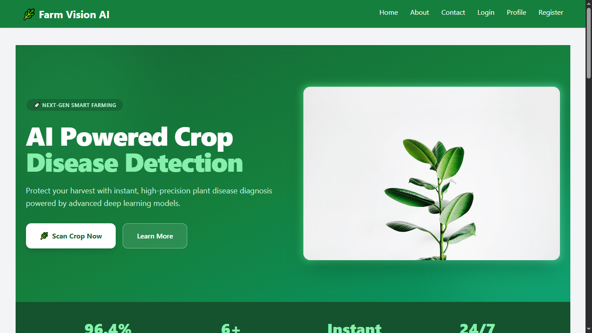
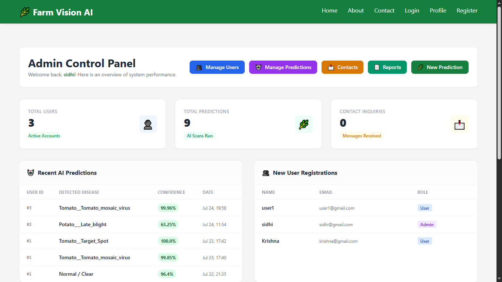
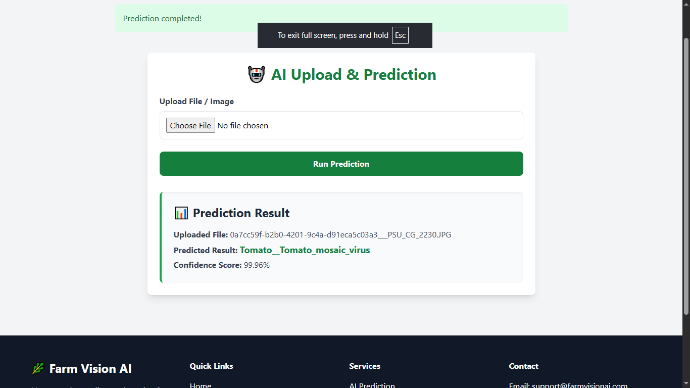

# Home Page 
# 🌿 Farm Vision AI

[Home](#) | [About](#) | [Contact](#) | [Login](#) | [Profile](#) | [Register](#)

---

### 🚀 NEXT-GEN SMART FARMING

# AI Powered Crop Disease Detection

Protect your harvest with instant, high-precision plant disease diagnosis powered by advanced deep learning models.

[🌿 Scan Crop Now](#)  [Learn More](#)

---

## Key Performance Indicators

* **96.4%** – ACCURACY RATE
* **6+** – CROP CATEGORIES
* **Instant** – DIAGNOSIS SPEED
* **24/7** – CLOUD ACCESS

---

## Smart Farming Gallery

Explore AI in action across real fields and crops.

---

## Why Crop Health Matters

Early detection prevents catastrophic harvest losses and supports global food security.

### 🌍 Oxygen & Ecosystem
Plants generate essential oxygen and preserve topsoil health across farming ecosystems.

### 🍅 Food Security
Early diagnosis protects high-yield crops against destructive bacterial and viral blights.

### 💰 Economic Value
Reduces chemical overuse by providing targeted treatments early in the infection cycle.

### 🌱 Sustainable Growth
Promotes organic farming practices through intelligent nutrient monitoring.

---

## Supported Crop Diagnoses

| Crop / Disease | Description | Action |
| :--- | :--- | :--- |
| **🥔 Potato Early Blight** | Fungal disease causing target-like concentric rings on older leaves. | [View Symptoms & Details](#) |
| **🍅 Tomato Yellow Leaf Curl** | Viral disease transmitted by whiteflies leading to stunted growth. | [View Symptoms & Details](#) |
| **🌿 Late Blight** | Rapidly spreading water-soaked lesions affecting leaves and stems. | [View Symptoms & Details](#) |
| **🍃 Mosaic Virus** | Causes mottled light and dark green patterns across foliage. | [View Symptoms & Details](#) |

---

## Smart Farming Best Practices

* **💧 Morning Watering**  
  Water crops early in the morning to minimize leaf dampness overnight and reduce fungal growth.

* **🧪 Nutrient Rotation**  
  Balance nitrogen and potassium inputs to protect plants against blight susceptibility.

* **🌿 Prune Infected Foliage**  
  Isolate and prune spotted leaves immediately to arrest spore transmission.

* **🌾 Crop Rotation**  
  Rotate nightshade crops seasonally to prevent disease buildup in soil.

---

## 🌿 Farm Vision AI
*AI-powered crop disease detection for smarter farming.*

### Quick Links
* [Home](#)
* [About](#)
* [Contact](#)

### Services
* AI Prediction
* Disease Library
* Crop Monitoring

### Contact Information
* **Email:** support@farmvisionai.com
* **Phone:** +91 XXXXX XXXXX

© 2026 Farm Vision AI. All rights reserved.

# Smart Admin Panel 
# 🌿 Farm Vision AI - Admin Control Panel

[Home](#) | [About](#) | [Contact](#) | [Login](#) | [Profile](#) | [Register](#)

---

# Admin Control Panel
Welcome back, **sidhi**! Here is an overview of system performance.

[👥 Manage Users](#) | [🤖 Manage Predictions](#) | [📩 Contacts](#) | [📄 Reports](#) | [🌿 New Prediction](#)

---

### 📊 Dashboard Overview

### 📊 System Overview

| Metric | Count | Subtext | Icon |
| :--- | :---: | :--- | :---: |
| **Total Users** | **2** | Active Accounts |  |

---

### 🤖 Recent AI Predictions

| User ID | Detected Disease | Confidence | Date |
| :---: | :--- | :---: | :---: |
| `#2` | `Potato___Late_blight` | **63.25%** | Jul 24, 11:54 |
| `#1` | `Tomato__Target_Spot` | **100.0%** | Jul 23, 17:42 |
| `#1` | `Tomato__Tomato_mosaic_virus` | **99.85%** | Jul 23, 17:40 |
| `#1` | `Normal / Clear` | **96.4%** | Jul 22, 21:35 |
| `#1` | `Normal / Clear` | **96.4%** | Jul 22, 21:35 |

---

### 👥 New User Registrations

| Name | Email | Role | Profile Avatar |
| :--- | :--- | :---: | :---: |

---

### 📩 Recent Contact Submissions

> *No contact messages submitted yet.*

---

## 🌿 Farm Vision AI
*AI-powered crop disease detection for smarter farming.*

### Quick Links
* [Home](#)
* [About](#)
* [Contact](#)

### Services
* AI Prediction
* Disease Library
* Crop Monitoring

### Contact Information
* **Email:** support@farmvisionai.com
* **Phone:** +91 XXXXX XXXXX

© 2026 Farm Vision AI. All rights reserved.

# User Panel 
# 🌿 Farm Vision AI User Dashboard

Below is a visual representation and structured summary of your personalized dashboard.

## 🖥️ Dashboard Overview

### 👤 Welcome, admin!
**Email:** *admin@gmail.com*

---

### 📊 Account Statistics

<table class="account-stats-table">
  <thead>
    <tr>
      <th>Metric</th>
      <th>Value</th>
    </tr>
  </thead>
  <tbody>
    <tr>
      <td><strong>Total Predictions</strong></td>
      <td class="stat-value">1</td>
    </tr>
    <tr>
      <td><strong>Account Role</strong></td>
      <td class="stat-value">Admin</td>
    </tr>
    <tr>
      <td><strong>Joined Date</strong></td>
      <td class="stat-value"><em>2026-07-22</em></td>
    </tr>
  </tbody>
</table>

---

### 🚀 Key Actions

#### 🤖 AI Upload & Prediction
Upload your data or images here to generate an automated AI report and diagnosis.

<a href="#new-prediction" class="button button-green">Start New Prediction</a>

---

#### 📜 Prediction History
View and download all your past results, generated reports, and historical records.

<a href="#view-history" class="button button-dark">View History</a>

---

### ℹ️ About Farm Vision AI
AI-powered crop disease detection for smarter farming.

### 🔗 Quick Links
- [Home](#)
- [About](#)
- [Contact](#)

### 🛠️ Services
- AI Prediction
- Disease Library
- Crop Monitoring

### 📞 Contact
- **Email:** support@farmvisionai.com
- **Phone:** +91 XXXXX XXXXX

---
© 2026 Farm Vision AI. All rights reserved.